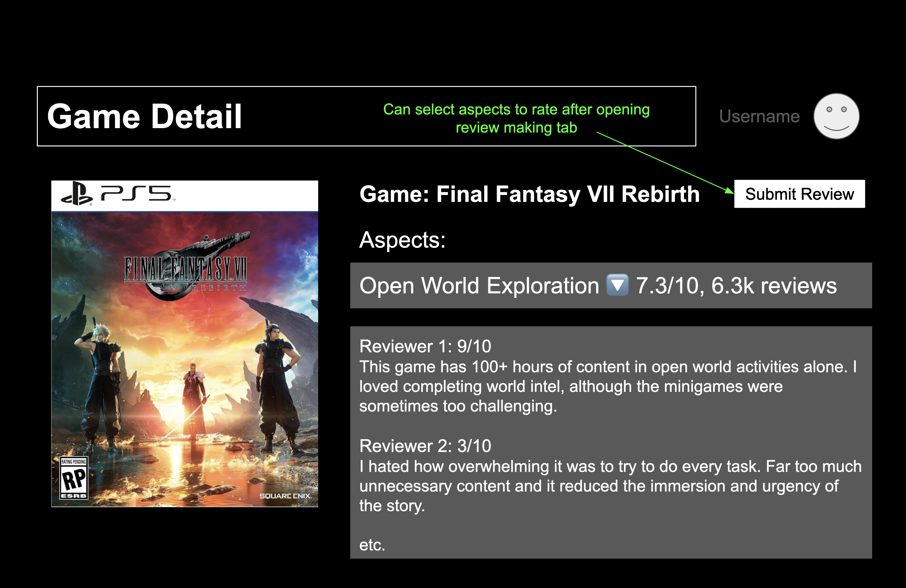
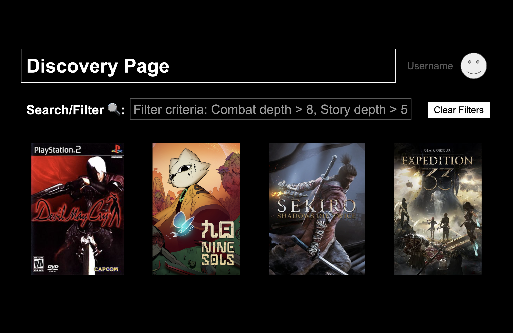

# Personal Project P1: Design — revised for P3

The framing and original sketches below come from P1. Section 3 was revised during P3
to address the released concept-design feedback. The original submitted version remains
in Git history. Current executable specifications are in [gamexplorer/design/](gamexplorer/design/).

**Application Name:** Gamexplorer  

---

## 1. Problem Framing and Stakeholders

### Domain
The domain of this project is video game discovery and evaluating them as prospective media in an interactive entertainment. Unlike linear media like movies or literature which require a few hours of passive consumption with no skill barrier, video games require substantial commitments of time (ranging from 30 to over 100 hours per game), a more significant financial investment ($70 per release), and different levels of physical/cognitive skill. This makes the process of choosing and reviewing video games a much more daunting task compared to linear media, and treating the review systems the same leads to inaccurate descriptions that can be misleading to the average user.

Because video games are interactive, player satisfaction is multidimensional. Gamers have very different preferences and prioritize different axes of the experience: some value deep tactical combat mechanics with high skill ceilings, while others seek rich narratives or a relaxing audiovisual atmosphere. This means it’s much harder to rate a game on a single scale and gain any use from this. A game will always comprise of distinct design tradeoffs and have a much larger variety across almost aspects compared to linear media, but we still use the same reviewing concept as movies when reviewing video games today.

### Stakeholders
* **Mechanics-Focused Gamers:** Players who prioritize intricate gameplay systems, combat depth, and physical responsiveness, and are willing to accept lower production value (e.g., dated graphics or lack of voice acting). An example of this might be something like the original Devil May Cry.
* **Story-Driven & Casual Gamers:** Players who care about immersive stories, beautiful graphics, and accessible learning curves, and might be frustrated by an extremely complex battle system. An example of this might be something like Final Fantasy XVI.
* **Indie Game Developers:** On the creators' side, this could help developers who have ideas for very specific and unique gameplay mechanics and don't have a high budget, but their titles might be rated with a low score overall on normal reviewing platforms due to low visual polish.
* **Prospective Buyers:** The general audience for this service would be consumers trying to evaluate whether a game’s specific strengths match their personal priorities before committing time and money, as it is a nontrivial investment.

### Bad Situations

#### Bad Situation 1: The "Flawed Masterpiece"
* **Scenario:** You are a gamer who loves skill-demanding melee combat systems and does not care about rich world building or voice acting. An independent studio releases a game featuring an innovative frame-accurate parry and combat system, but has a surface-level story and no voice acting due to budget constraints. Mainstream aggregate review sites give the game an overall rating of 3 out of 5 stars because reviewers average down the score to reflect its modest visual presentation.
* **Consequence:** You see the 3/5 star average on standard recommendation feeds and skip purchasing the game, because all the top reviews are complaining about the lack of story without appreciating the other aspects of the game. The indie developer suffers poor sales despite having an extremely well-designed combat system, and you miss out on a title that would have been their favorite game of the year.

#### Bad Situation 2: Reviewer Misinterpretation
* **Scenario:** Your friend finishes a 60 hour RPG and wants to leave a review praising its skill tree customization while warning prospective buyers about the fact that the skippable side quests are uninteresting and make the progression of the game seem boring if you force yourself to do them. On existing review platforms, your friend is forced either to assign a single rating like 7/10, or fill out a rigid form containing sections that are irrelevant to their review (*Graphics*, *Soundtrack*, etc.). Your friend either ends up leaving a review that has no way of fully capturing their thoughts or ends up writing a long, essay-like review that new buyers don't feel like reading compared to observing easily-digestible aggregate scores.
* **Consequence:** Existing platforms lose valuable multi dimensional insight on games. Prospective buyers are left with either inaccurate reviews or extremely long review sections that require a significant time input just to fully parse and understand whether it would be appealing.

### Corroboration
Discussions across dedicated gaming communities highlight the failure of single-number ratings. On platforms like Reddit (`r/backloggd` and `r/Games`), countless users have made posts about how they chose to play a game despite bad reviews, only to be confused when they found out the game was perfect to them. These "flawed masterpieces" are hidden beneath low aggregate star ratings. These communities express overall frustration over having to mine hundreds of text comments to discover whether a game's low score stems from genuine mechanical flaws or merely secondary budget constraints. As a gamer myself, my friends and I have been hesitant to play games because of bad reviews online but found those games to be life-changing. On the opposite side, we've also played games that have huge cult followings and overwhelmingly positive reviews that we had to put down after an hour or so of gameplay because it wasn't our style.

### Workarounds and Comparables
* **Backloggd:** They market themselves as Letterboxd for games, and use a similar reviewing system as movies like on Letterboxd. It relies on a single overall 1 to 5 star rating scale. Users are forced to manually read through pages of prose reviews to find raters with similar playstyles and priorities.
* **Steam Tags:** Allows users to apply categorical labels (e.g., "RPG", "Psychological Horror"). Tags indicate the *presence* of a feature, but convey zero information regarding its *quality of execution* or *depth*. These tags often don't provide much information by simply stating a game as an "RPG" or "Roguelike."
* **Metacritic / IGN:** Displays single review scores paired with static review text. Critics weigh dimensions arbitrarily, making aggregate scores non-comparable across different user preference profiles or across different types of games.

### Solution Sketch
**Gamexplorer** is an aspect-based game evaluation and discovery platform. Instead of forcing reviewers into a single scalar score or a rigid set of mandatory categories, Gamexplorer allows users to submit quantitative ratings (1–10) and short reviews for **optional, dynamic aspect dimensions** (e.g., *Combat Depth*, *Pacing*, *Visual Atmosphere*, *Difficulty*). Raters only need to evaluate the dimensions they care about. Prospective buyers can then discover games by setting custom multi criteria filters on the specific gameplay dimensions that matter to them.

---

## 2. Application Pitch

* **Name:** Gamexplorer
* **Motivation:** Single scalar star ratings collapse the multidimensional tradeoffs of video games, which means some stellar aspects of games get hidden behind average overall scores. Because of this, buyers are overwhelmed with long walls of texts as reviews to parse before they can make a decision on whether to invest their time and money into game.
* **Key Features:**
  1. **Sparse Aspect Rating:** Reviewers can evaluate only the gameplay dimensions they care about (e.g., scoring *Combat Depth* 9/10 and *Pacing* 5/10 while skipping *Graphics* entirely). They can explain those scores without evaluating aspects they have not played or do not care about.
  2. **Multi-Criteria Dimensional Search:** Prospective buyers can filter the catalog using specific threshold criteria across dimensions (e.g., *Combat Depth* ≥ 8 AND *Learning Curve* ≥ 5), instantly uncovering hidden gems that align with their personal playstyle. Think almost like shopping for clothes, where you can filter by material or length, but for games.
  3. **Aspect Micro-Notes:** Reviewers can attach 1–2 sentence explanations *directly* to individual dimension scores, so prospective buyers can understand their reasoning or context without having to read a full, lengthy review.

---

## 3. Conceptual Design

### Concepts and responsibilities

The current application composes five concepts. Three handle reusable evaluation mechanisms; the
application supplies their game-specific meanings. The linked definitions contain each
concept's purpose, principle, state, actions, queries, and refusal cases.

| Concept | Purpose and defining behavior | Gamexplorer instantiation |
| --- | --- | --- |
| [UserAuthenticating](gamexplorer/design/concepts/UserAuthenticating.md) | Establish an account identity: a valid password or confirmed external identity starts a session; an expired or logged-out session no longer authorizes requests. | Owns local user identities and sessions. |
| [GameCatalog](gamexplorer/design/concepts/GameCatalog.md) | Give a game one catalog identity: adding it makes it searchable; adding the same normalized title again is refused. | Owns game identities, metadata, and optional Steam cover URLs. |
| [DimensionDefining [Subject]](gamexplorer/design/concepts/DimensionDefining.md) | Prevent ambiguous evaluation categories: defining a name yields a stable dimension for that subject, while another subject can use the same name for a different dimension. | GameDimensions takes a GameCatalog game as Subject. Its Dimension is shown as an aspect. |
| [Rating [Rater, Target]](gamexplorer/design/concepts/Rating.md) | Compare independent evaluations without counting the same rater twice: several raters evaluate a target; replacement updates one contribution and removal withdraws it from the average. | DimensionRatings takes a user as Rater and a dimension as Target. |
| [ThresholdFiltering [Owner, Item]](gamexplorer/design/concepts/ThresholdFiltering.md) | Find items satisfying all of an owner's minimum requirements: record named numeric values, set criteria, and match only items meeting every criterion; withdrawing a value removes its support for a match. | GameDiscovery takes a user as Owner and game as Item; compositions supply dimension averages as values. |

The generic concepts do not inspect their external identities. Rating has no parent-game
argument and does not require DimensionDefining: it can rate book identities directly.
DimensionDefining can define restaurant service dimensions. ThresholdFiltering can match
rooms by capacity or negative temperature values without any reviews. These uses are
exercised in the unit tests. The application still restricts discovery thresholds to 1–10.

[Type instantiations](gamexplorer/design/types.md) connect identities; they do not give one
concept access to another's properties. Each implementation owns an isolated collection.
Game-specific names, catalog existence checks, authentication, and display joins belong
in compositions. Keeping existing MongoDB column encodings preserves P2 deep links,
review ownership, and saved criteria. Compatibility tests create old state through
archived concept actions and exercise the current endpoints against it.

### Essential composition rules

The three rules below maintain discovery values. Each is a separate linkage. Queries
read facts in `where`; only actions appear in `then`. The names below are the application
instances, and a dimension is passed as its identity rather than an object containing
its game or name.

```text
when DimensionRatings.rate(rater, target, score, note) succeeds
where GameDimensions._get(target) yields subject and name
      DimensionRatings._summary(target) yields average and count, with count > 0
then GameDiscovery.recordValue(item: subject, criterion: name, value: average)

when DimensionRatings.remove(rater, target) succeeds
where GameDimensions._get(target) yields subject and name
      DimensionRatings._summary(target) yields average and count, with count > 0
then GameDiscovery.recordValue(item: subject, criterion: name, value: average)

when DimensionRatings.remove(rater, target) succeeds
where GameDimensions._get(target) yields subject and name
      DimensionRatings._summary(target) yields count 0
then GameDiscovery.forgetValue(item: subject, criterion: name)
```

The [Catalog composition](gamexplorer/design/compositions/Catalog.md) checks that a game
exists before defining a dimension. Its game-detail former joins that game's dimensions
with evaluations and reviewer names. This gives DimensionDefining a role in both the
reviewing and discovery paths, rather than leaving it as an unexplained table.

The [Rating composition](gamexplorer/design/compositions/Rating.md) first resolves the
server-provided session with UserAuthenticating.current. Only its successful user identity
can reach a rate or remove action; an unknown dimension or invalid session is refused.
My Ratings joins the resulting target identities back to dimension names and game titles.
The [Discovery composition](gamexplorer/design/compositions/Discovery.md) similarly derives
criterion ownership from the session. Neither endpoint trusts a client-supplied user.

The [Commons composition](gamexplorer/design/compositions/Commons.md) verifies an external
sign-in, links its subject to a local user, and starts a session. Password sign-in remains
in [Accounts](gamexplorer/design/compositions/Accounts.md). The generated
[application contract](gamexplorer/generated/gamexplorer.md) records the implemented
endpoints, requests, responses, and linked concept actions.

Read-only catalog, detail, and discovery requests form responses from queries. They do
not fire reactions merely to observe data. No reaction passes a collection of Rating's
internal records into ThresholdFiltering.

---

## 4. UI Sketches

These are the original P1 sketches. The P3 reviewer interface is documented below them. The illustrative journey uses hypothetical scores, not imported reviews.

### Screen 1: Game Detail & Aspects Overview
**

### Screen 2: Discover Page
**

### P3 reviewer interface

The implemented [game page](gamexplorer/web/pages/GamePage.ts) includes an expandable
aspect with a labelled 1–10 score input, optional review, save/update action, and removal
confirmation. My Ratings links back to the exact aspect for editing. Unchosen aspects
remain unrated. The [current interface capture](gamexplorer/validation/screenshots/reviewer-refinement.jpg)
shows this reviewer path. The [shared aspect picker](gamexplorer/validation/screenshots/shared-aspect-picker.jpg)
now offers presets before a separate custom-name form; [the user journey](README.md#user-journey)
describes discovery and reviewing together.

## 5. User Journey

You work 40 hours a week and only have about 8 hours of gaming time available per week. You recently bought two $70 AAA titles with awesome cinematic visuals but a disappointing and shallow story, so you are determined not to waste your limited leisure time or money on another unenjoyable game. Standard review sites offer only aggregate star ratings, which hide whether a score is low due to poor combat mechanics or merely modest graphics.

Seeking a game with a deeply engaging narrative and rich world-building regardless of its budget or production polish, you open Gamexplorer and navigate to the Discovery page (Screen 2). Rather than typing vague terms like "story-driven" into a search bar, you check the filter box for Narrative Depth and set the minimum score slider to 8/ 10. You leave raw combat complexity and visual requirements unconstrained, allowing the platform to evaluate games based on storytelling quality.

Gamexplorer executes the query and highlights an indie RPG with an overall average of 5.5/10 stars on most mainstream aggregate sites because it has retro pixel art visuals and simple turn based combat. On Gamexplorer, however, you see that its average Narrative Depth score is an impressive 9.0/10 across 58 story-focused reviewers.

Intrigued, you click on the game cover to open its Game Detail page (Screen 1). Then, you expand the Narrative Depth tab to read targeted mini reviews submitted by previous players that describe how the story was gripping throughout every part of the game. This targeted feedback gives you confidence in purchasing the game without having to read through pages of lengthy and potentially spoiler-filled prose reviews.

You are convinced that the game fits your exact priorities, so you purchase and play the game. You thoroughly enjoy a rich 15-hour story. After completing the main narrative, you return to Gamexplorer, open the game's page, select Narrative Depth, and submit a score of 9 / 10 along with a short review praising the well-written character dialogue. Because Gamexplorer permits sparse ratings, you leave the Visual Polish and Combat Complexity dimensions unrated, avoiding the need to penalize the developer for budget limitations or distort the game's overall breakdown. With Gamexplorer you were able to discover and enjoy a wonderful game, in addition to sharing your love for the game with other like-minded gamers.
